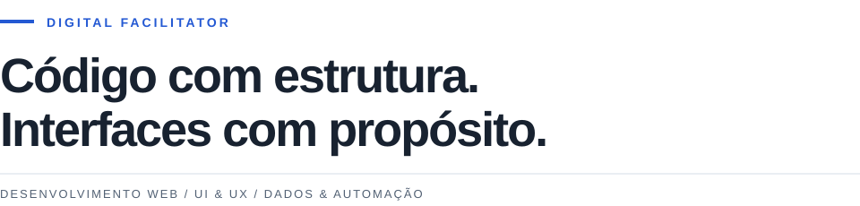

<picture>
  <source media="(prefers-color-scheme: dark)" srcset="assets/header-dark.svg">
  <source media="(prefers-color-scheme: light)" srcset="assets/header-light.svg">
  
</picture>

### Desenvolvimento & experiência

Sites responsivos, temas WordPress e integrações, com atenção à estrutura, à interface e à usabilidade.

  

Photoshop · Illustrator

### Dados & processos

Dashboards e indicadores para apoiar decisões. Aplicativos internos e automações para simplificar rotinas.

**Power BI** &nbsp; / &nbsp; **Power Apps** &nbsp; / &nbsp; **Power Automate** &nbsp; / &nbsp; **SharePoint**

---

Git & GitHub · Versionamento e organização de projetos
